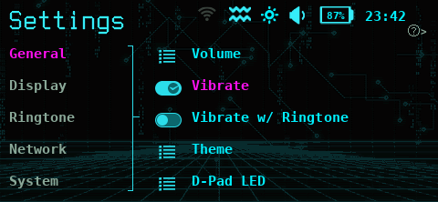
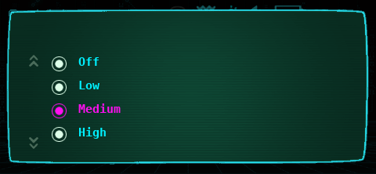
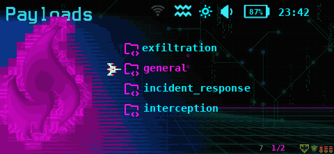
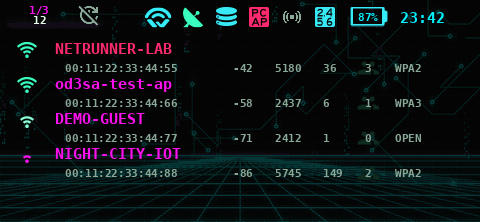
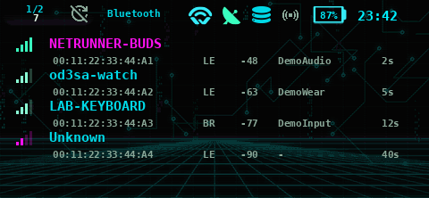

# netrunner-od3sa

A WiFi Pineapple Pager theme for the [Hak5 WiFi Pineapple Pager](https://hak5.org/products/wifi-pineapple-pager).

Layout matches the official [wifipineapplepager-themes](https://github.com/hak5/wifipineapplepager-themes) collection: the installable theme lives under `themes/netrunner-od3sa/`.

## Install

1. Copy `themes/netrunner-od3sa` onto the Pager at `/mmc/root/themes/netrunner-od3sa`.
2. On the Pager, open Themes and select **netrunner-od3sa**.

## Theme

See [themes/netrunner-od3sa/README.md](themes/netrunner-od3sa/README.md) for palette, credits and known limitations.

**Author:** Yakov Khalinsky

## Screenshots

_Mock renders from the theme files, not yet captured on hardware._

| | |
|---|---|
|  |  |
|  |  |
|  |  |
|  |  |

### Boot screen

The "JACKING IN" boot animation, taken frame for frame from the theme's own boot images.

| | |
|---|---|
|  |  |
|  |  |
